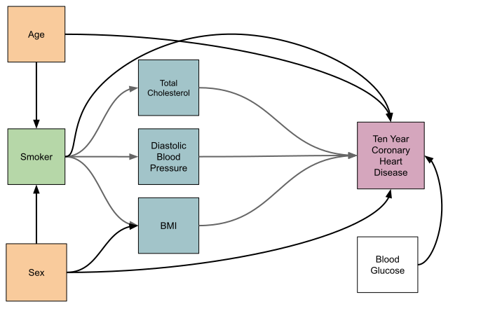

## The Dataset
The Framingham Heart Study was started in 1948 by the National Heart Institute 
with the goal of identifying common factors that contribute to cardiovascular 
disease. The data used in this guide comes 
[Framingham Heart Study - CHD Risk Prediction](https://github.com/KomlaAkpalu/Framingham-CoronaryHeartDisease-Modeling/tree/main) 
and was cleaned and prepared by them. The data contained in this dataset are
cross-sectional, meaning that there is only one measurement per subject. Since
this guide is focused on constructing an effects model, only complete cases
($n=3828$) are considered so that there is no missing data. A proper analysis
would need to consider missing data rigorously.

The dataset contains the following variables:

**Categorical variables**:

- `sex` - The biological sex of the subject. A factor with two levels: `Fem` and `Mal`.
- `smoker` - Is subject a current smoker? A factor with two levels: `No` and `Yes`.
- `haschd` - Does the subject have coronary heart disease? A factor with two levels: `No` and `Yes`.

**Continuous variables**:

- `age` - The age, in years, of the subject.
- `totChol` - The total cholesterol ($mg/dL$) of the subject.
- `diaBP` - Diastolic blood pressure ($mmHg$) of the subject.
- `BMI` - The body mass index ($kg/m^2$) of the subject.
- `glucose` - The casual serum glucose (mg/dL) of the subject.

```{r initial setup}
library(tidyverse)
theme_set(theme_bw())
chd <- read_csv("framingham.csv") |> 
  select(male, age, currentSmoker, totChol, diaBP, BMI, glucose, TenYearCHD)

chd <- chd[complete.cases(chd),]

chd <- chd |> 
  mutate(
    sex = if_else(male == 1, "Male", "Female") |> factor(levels=c("Female", "Male")),
    smoker = if_else(currentSmoker == 1, "Yes", "No") |> as_factor(),
    haschd = if_else(TenYearCHD == 1, "Yes", "No") |> as_factor()
  ) |> 
  select(-c(male, currentSmoker, TenYearCHD))
```

## The Causal Model
Imagine that you are a researcher who studies smoking and its impact on health.
You are interested in quantifying the effect of smoking on coronary heart
disease. The Framingham Heart Study data provides you with an observational
study (subjects were not randomly assigned to either smoke or not, the ethics of
that would be horrific!) but you are interested in making causal inference. A
causal model can help you construct a model that will allow you to make causal
statements, but you need to consider potential [confounders](confounders.html)
and [mediators](mediators.html). You are interested in the *direct effect* of
smoking on coronary heart disease, so you need to include mediators in your
model in order to determine the direct effect. The causal model shown below is
one possible model and we will explore this model in this guide.

This model posits that age and sex are confounders. There are three mediators of
the effect of smoking on coronary heart disease: Body mass index, diastolic
blood pressure and total cholesterol. Additionally, there is an independent
predictor, blood glucose, that may be useful in increasing the precision of the
direct effect estimate.

{width=80%}


## Univariate Analyses
Analyses will be conducted on each variable. In the case of continuous variables,
descriptive statistics will tabulated and distribution plots created. For
categorical variables, a simple percentage of each level will be computed. 
Because we are only considering complete cases, we don't need to consider
missingness or a strategy for imputing missing data.

### Continuous Variables
The five continuous variables are summarised in the table below. Study subjects
range in age from 32 to 70 years with a mean age of 49.6 years and standard
deviation of 8.6 years. The distribution is relatively symmetric. The remaining
variable distributions all exhibit positive skew with BMI and diastolic BP
exhibiting modest right tails and total cholesterol and blood glucose exhibiting
more extreme outliers in their right tails. The outliers in these distributions 
are valid so sensitivity analyses will be performed to assess how influential
the outliers are on hypothesis tests and estimates of effect size. Table 1 
provides detailed descriptive statistics for each variable. See figure 1 for
variable distributions.

```{r univariate descriptive statistics}
library(psych); library(gt)
# a helper function to return descriptive stats for a given variable
univariate_summary <- function(data) {
  describe(data, IQR=TRUE) |> 
    select("Mean"=mean, "SD"=sd, "Median"=median, "Min"=min, "Max"=max, IQR)
}

# smash all of the summaries into a dataframe that can be used to generate a
# table.
var_summaries <- bind_rows(
  univariate_summary(chd$age),
  univariate_summary(chd$totChol),
  univariate_summary(chd$diaBP),
  univariate_summary(chd$BMI),
  univariate_summary(chd$glucose)
)

rownames(var_summaries) <- 
  c("Age", "Total Cholesterol", "Diastolic BP", "Body Mass Index", "Blood Glucose")

# render the table of descriptive statistics
var_summaries |> 
  gt(rownames_to_stub=TRUE) |> 
  fmt_number(decimals=1)
```

Table 1: Descriptive statistics for continuous covariates: Age (yr), total 
cholesterol (mg/dL), diastolic BP (mmHg), BMI ($kg/m^2$) and blood glucose (mg/dL).

```{r univariate distribution plots}
#| fig-height: 6
#| fig-width: 10
#| fig-cap: "Figure 1: Histogram and density plots of the five continuous variables."
#| fig-align: "center"
library(patchwork); library(latex2exp) # use the TeX function for latex label

# helper function to to create a histogram/density plot for a given variable
univariate_plot <- function(data, field, xlab, bins=30) {
  ggplot(data, aes(x={{field}})) + 
    geom_histogram(aes(y = after_stat(density)), colour="black", bins=bins, fill="white", alpha=0.7) +
    geom_density(linewidth=1, fill="seagreen", alpha=0.2) + 
    labs(x=xlab, y="Density")
}

# use patchwork to create a nice aggregate plot with 2 rows
(
  univariate_plot(chd, age, "Age (yr)", bins=10) + 
  univariate_plot(chd, totChol, "Total Cholesterol (mg/dL)") +
  univariate_plot(chd, diaBP, "Diastolic Blood Pressure (mm Hg)", bins=25)
)/(
  univariate_plot(chd, BMI, TeX("Body Mass Index ($kg/m^2$)")) +
  (univariate_plot(chd, glucose, "Blood Glucose (mg/dL)") +
  geom_vline(xintercept=126, linewidth=1, linetype="dashed", colour="grey30") +
  annotate("text", label="126 mg/dL cutoff for Diabetes diagnosis", x=140, 
           y=0.025, hjust=0.05))
)
```

**Tabulate the number of outliers in each continuous variable in a table here.**

```{r tabulate outliers}

```


### Categorical Variables
There are three categorical variables in the dataset: `sex`, `smoker` and 
`haschd`. All three are dichotomous (have two possible outcomes) variables. The
sample has a nearly even split between smokers and non-smokers (50.9% v 49.1%)
and males and females (44.4% v 56.6%). A majority (84.7%) of the sample subjects
did not have coronary heart disease at their ten year point in the study.

```{r categorical plots}
#| fig-width: 10
#| fig-height: 3.5
#| fig-align: "center"
pie_data <- function(data, field) {
  data.frame(
    variable = levels(data[[field]]),
    counts = table(data[[field]]) |> as.matrix()
  ) |> mutate(pct = paste((counts/nrow(chd)*100) |> round(1), "%", sep=""))
}

plot_pie <- function(data) {
  data |> 
  ggplot(aes(x = "", y = counts, fill = variable)) +
    geom_col(color = "black") +
    geom_text(aes(label = pct),
              position = position_stack(vjust = 0.6)) +
    coord_polar(theta = "y") +
    scale_fill_brewer() +
    theme_void() +
    theme(legend.position="bottom")
}

p1 <- (pie_data(chd, "sex") |> plot_pie()) + labs(fill=as.character("Sex")) + 
  ggtitle("Biological Sex")

p2 <- (pie_data(chd, "smoker") |> plot_pie()) + labs(fill=as.character("Smoker")) + 
  ggtitle("Smoking Status")

p3 <- (pie_data(chd, "haschd") |> plot_pie()) + labs(fill="Has CHD") + 
  ggtitle("CHD Status")

p1 + plot_spacer() + p2 + plot_spacer() + p3 + plot_layout(ncol = 5)
```

## Bivariate Exploratory Analyses
Bivariate comparisons should be conducted to assess the correlations between
continuous variables, group distributions for continuous/categorical pairs of
variables and the independence of categorical variable pairs. All pairwise
combinations will be examined.

### Continuous Variable Correlation Plots
First, scatter plots and correlations between variable pairs can be computed
using the `ggpairs()` function from the `GGally` package. We know from the
univariate analysis that three of the variables (`diaBP`, `totChol` and
`glucose`) have many outliers and the distributions are reasonably skewed so the
assumptions of normality of the data and no/few outliers of Pearson's
correlation are violated. Kendall's $\tau$ is used to compute correlations as it
does not make these assumptions. The relationships between variables in the
plots appear to be monotone and we know that all of these variables are ratio so
the assumptions of the method are satisfied.

```{r pairs plot}
#| fig-height: 6
#| fig-width: 10
#| fig-cap: "A comparison of age, total cholesterol, diastolic blood pressure, body mass index and blood glucose in the sample study ($n=3828$)."
#| fig-align: "center"
library(GGally)
chd |> select(age, totChol, diaBP, BMI, glucose) |> 
  ggpairs(progress=FALSE, upper = 
            list(continuous = wrap("cor", method = "kendall")))
```
The plots and correlations indicate that the variables are at most weakly 
correlated ($0.1 \leq \tau < 0.4$) with many variable pairs being uncorrelated 
($\tau < 0.1$). These variables appear to be independent of one another and some
of them may be useful independent predictors of coronary heart disease risk.

### Categorical/Continuous Variable Plots 
Each categorical variable is plotted with each continuous variable. The 
distribution of each continuous variable is compared across the levels of the
categorical variable with box plots. Group mean comparisons will be made using
t-tests and effect sizes estimated with Cohen's d (using rstatix package 
`cohens_d()` function). The effect size magnitude is assessed using the standard
thresholds provided by Cohen: $|d| < 0.2$ "negligible", $|d| < 0.5$ "small", 
$|d| < 0.8$ "medium", otherwise "large". Due to the presence of outliers,
sensitivity analyses will be performed using Winsorised data and nonparametric
mean comparison with the Mann-Whitney test.

#### Biological Sex

```{r categorical v continuous bivariate plots sex}
#| fig-height: 6
#| fig-width: 10
#| fig-cap: "A comparison of age, total cholesterol, diastolic blood pressure, body mass index and blood glucose between males and females in the sample study ($n=3828$)."
#| fig-align: "center"
plot_box <- function(data, field1, field2, xlab="", ylab="") {
  ggplot(data=data, aes(x={{field1}}, y={{field2}})) + 
    geom_boxplot() + 
    coord_flip() + 
    labs(x=xlab, y=ylab)
}

plot_box(chd, sex, age, "Sex", "Age (yr)") + plot_box(chd, sex, totChol, "Sex", "Total cholesterol (ml/dL)") +
plot_box(chd, sex, diaBP, "Sex", "Diastolic BP (mm Hg)") + plot_box(chd, sex, BMI, "Sex", TeX("Body mass index ($kg/m^2$)")) +
plot_box(chd, sex, glucose, "Sex", "Blood Glucose (mg/dL)") + plot_layout(axes="collect")
```
There do not appear to be any substantive differences between the continuous
variables and biological sex except age and possibly body mass index. To confirm
what the plots show us, we perform t-tests and measure effect size with Cohen's
d. Because the sample size is so large here ($n=3828$) the test will enough
power to detect even trivial differences in the two group means. This is why a
measure of effect size is helpful. Given that there are many outliers in many of
these variables (with the exception of age which is capped at 70 years), we need
to conduct a sensitivity analysis to see if the presence of outliers is biasing
the estimated difference between the group means. We will use 2 methods to test
sensitivity here: Excluding outliers and rank-based effect size estimation. If
the results of the standard t-test agree with these other methods, then we can
reliably use the parametric test and effect size. If not, then the nonparametric
rank-based test and effect size will be used instead.

##### Age v Sex
Age does not have any outliers and the variances look roughly equal based on the
plot. Levene's test can be used to assess homogeneity of the variances of men and
women.

```{r}
library(rstatix)
levene_test(chd, age ~ sex) |> round(4) |> select(statistic, p) |> 
  gt()
```
With $p=0.5598$, the null hypothesis of equal variances cannot be rejected. 

The data are right skewed, so the assumption of normality of the outcome is
violated. However, the two-sample test is reasonably robust to departures from
normality. Comparison with the results of a nonparametric method will allow us
to assess if the data are "normal enough".

```{r age v sex sensitivity test}
t_result <- t.test(age ~ sex, data = chd)
wilcox_result <- wilcox.test(age ~ sex, data = chd, exact = FALSE)
W <- wilcox_result$statistic
```

| Test | Statistic | p value |
|----------|----------|-----------|
| T-test | `r t_result$statistic` | `r t_result$p.value` |
| Mann-Whitney | $`r W`$ | `r wilcox_result$p.value` |

The conclusion of both tests is the same: There is not enough evidence to reject
the notion that the mean age of men and women in the study population is the 
same.

##### Total Cholesterol v Biological Sex
Total cholesterol does have a substantial number of outliers and the box plot
by biological sex suggests that the variances are not equal. In order to
determine if the outliers are biasing the estimate of the difference in means of
the standard t test, both a t-test excluding outliers will be conducted as well
as a non-parametric test.

```{r totChol v sex}
library(effsize)
# helper function that applies a standard t test, a t test excluding outliers,
# and the Mann-Whitney non-parametric test and Cohen'd and Cliff's Delta for
# effect sizes to a continuous outcome and dichotomous predictor. The results of
# all three scenarioes are then tabulated and returned.
sensitivity_table <- function(outcome, exposure) {
  test_formula <- as.formula(paste(outcome,"~",exposure))
  basic.t <- t.test(test_formula, chd)
  basic.d <- cohens_d(chd, test_formula, ci=TRUE, ci.method="analytic")
  
  # use truncated data (no outliers) to create dataset for t/cohen's d
  value <- chd[outcome] |> unlist() |> as.numeric()
  quants <- quantile(value, probs=c(0.25, 0.75)) # values in the IQR
  IQR.mag <- IQR(value)
  
  chd_no_outliers <- chd |> 
  mutate(
    is_outlier = if_else(between(get(outcome), quants[1] - 1.5*IQR.mag, 
                                 quants[2] + 1.5*IQR.mag), FALSE, TRUE)
  ) |> filter(!is_outlier)
  
  # now that data have been truncated to remove outliers, perform t test and
  # assess effect size
  trunc.t <- t.test(test_formula, data=chd_no_outliers)
  trunc.d <- cohens_d(chd_no_outliers, test_formula, ci=TRUE, 
                      ci.method="analytic")
  
  # now assess effect size with Mann-Whitney and Cliff's Delta
  U <- wilcox.test(test_formula, data = chd, exact=FALSE)
  CD <- cliff.delta(test_formula, data = chd)
  
  # smash all of the results together into a single data frame to tabulate
  bind_rows(
    tibble(Method = "Standard t-test / Cohen’s d", 
           `Effect size` = basic.d$effsize, 
           p.value = basic.t$p.value, 
           `95% CI` = paste("[",round(basic.d$conf.low,3), ",", 
                            round(basic.d$conf.high,3), "]", sep=""),
           Magnitude = basic.d$magnitude),
    tibble(Method = "Outliers excluded", 
           `Effect size` = trunc.d$effsize, 
           p.value = trunc.t$p.value, 
           `95% CI` = paste("[",round(trunc.d$conf.low,3), ",", 
                            round(trunc.d$conf.high,3), "]", sep=""),
           Magnitude = trunc.d$magnitude),
    tibble(Method = "Mann-Whitney / Cliff’s delta", 
           `Effect size` = CD$estimate, p.value = U$p.value, 
           `95% CI` = paste("[",round(CD$conf.int["lower"],3), ",", 
                            round(CD$conf.int["upper"],3), "]", sep=""),
           Magnitude = as.character(CD$magnitude))
  ) |> 
    mutate(
      p.value = scales::pvalue(p.value, accuracy=0.0001)
    ) |> 
    gt() |> 
    fmt_number(decimals=3)
}

sensitivity_table("totChol", "sex")
```

The results of all three tests agree on direction and magnitude. While the test
results are statistically significant, the effect size is negligible 
($|d| < 0.2$). This suggests that we can treat total cholesterol as being 
independent of biological sex.

##### Diastolic Blood Pressure v Biological Sex
Like most of the other continuous predictors, there are a considerable number of
outliers and like total cholesterol, there is a long right tail in the 
distribution of observations.

```{r diaBP v sex}
sensitivity_table("diaBP", "sex")
```

As before, the results of all three tests agree on direction and magnitude.
While the test results are statistically significant, the effect size is
"negligible". This suggests that we can treat diastolic blood pressure as being
independent of biological sex.

##### Body Mass Index v Biological Sex
Body mass index is typically lower in males than females, so a non-negligible
effect size is expected. Like the other continuous predictors there is a
positive skew. Given the number of outliers and the skew, it is again worth
performing a sensitivity analysis to determine if a nonparametric method is
required for an unbiased estimate.

```{r bmi v sex}
sensitivity_table("BMI", "sex")
```
The direction of the effect is the same across the three methods used. The
Mann-Whitney and excluded outliers methods agree on the magnitude of the effect.
The given that the assumptions of the standard t-test have been violated, the 
nonparametric method is preferred in this instance. The conclusion is that there
is a difference in mean BMI between males and females in the study population.
Biological sex is likely a confounder for the BMI/CHD relationship. This will 
not directly impact the proposed causal model, but it is useful to note.

##### Blood Glucose v Biological Sex
The distribution of blood glucose is the most skewed of the five continuous
variables considered in the proposed causal model. The variance may be constant
across across males and females, but the large number of outliers will again
require an sensitivity analysis.

```{r glucose v sex}
sensitivity_table("glucose", "sex")
```

All three methods indicate that there is no evidence that the difference in mean  
blood glucose levels between males and females is reliably different to zero.

#### Smoking Status

```{r categorical v continuous bivariate plots smoking}
#| fig-height: 6
#| fig-width: 10
#| fig-cap: "A comparison of age, total cholesterol, diastolic blood pressure, body mass index and blood glucose between smokers and nonsmokers in the sample study ($n=3828$)."
#| fig-align: "center"

plot_box(chd, smoker, age, "Smoker", "Age (yr)") + plot_box(chd, smoker, totChol, "Smoker", "Total cholesterol (ml/dL)") +
plot_box(chd, smoker, diaBP, "Smoker", "Diastolic BP (mm Hg)") + plot_box(chd, smoker, BMI, "Smoker", TeX("Body mass index ($kg/m^2$)")) +
plot_box(chd, smoker, glucose, "Smoker", "Blood Glucose (mg/dL)") + plot_layout(axes="collect")
```
These boxplots indicate that there are a substantial number of outliers for
smokers as well as nonsmokers. The univariate analyses show that the
distributions are skewed/asymmetric so the assumptions of the t-test are
violated.

##### Age v Smoking

```{r}
library(rstatix)
levene_test(chd, age ~ smoker) |> round(4)
```

##### Total Cholesterol v Smoking

```{r total cholesterol v smoking sensitivity}
sensitivity_table("totChol", "smoker")
```

##### Diastolic Blood Pressure v Smoking Status

```{r diastolic BP v smoking sensitivity}
sensitivity_table("diaBP", "smoker")
```

##### Body Mass Index v Smoking Status

```{r BMI v smoking sensitivity}
sensitivity_table("BMI", "smoker")
```


##### Blood Glucose v Smoking Status

```{r glucose v smoking sensitivity}
sensitivity_table("glucose", "smoker")
```


```{r}
bind_rows(
  cohens_d(chd, BMI ~ smoker),
  cohens_d(chd, age ~ smoker),
  cohens_d(chd, totChol ~ smoker),
  cohens_d(chd, diaBP ~ smoker),
  cohens_d(chd, glucose ~ smoker)
) |> 
  select("Variable"=.y., "Effect size"=effsize, "Magenitude"=magnitude) |> 
  gt() |> 
  fmt_number(decimals=2)
```


```{r categorical v continuous bivariate plots CHD}
#| fig-height: 6
#| fig-width: 10
#| fig-cap: "A comparison of age, total cholesterol, diastolic blood pressure, body mass index and blood glucose between those with and without CHD in the sample study ($n=3828$)."
#| fig-align: "center"

plot_box(chd, haschd, age, "Has CHD", "Age (yr)") + plot_box(chd, haschd, totChol, "Has CHD", "Total cholesterol (ml/dL)") +
plot_box(chd, haschd, diaBP, "Has CHD", "Diastolic BP (mm Hg)") + plot_box(chd, haschd, BMI, "Has CHD", TeX("Body mass index ($kg/m^2$)")) +
plot_box(chd, haschd, glucose, "Has CHD", "Blood Glucose (mg/dL)") + plot_layout(axes="collect")
```
There are small effects of   


```{r}
bind_rows(
  cohens_d(chd, BMI ~ haschd, ci=TRUE),
  cohens_d(chd, age ~ haschd, ci=TRUE),
  cohens_d(chd, totChol ~ haschd, ci=TRUE),
  cohens_d(chd, diaBP ~ haschd, ci=TRUE),
  cohens_d(chd, glucose ~ haschd, ci=TRUE)
) |> 
  mutate(
    CI = paste("[", conf.low, ",", conf.high , "]", sep="")
  ) |> 
  select("Variable"=.y., "Effect size"=effsize, "95% CI"=CI, "Magenitude"=magnitude) |> 
  gt() |> 
  fmt_number(decimals=2)
```


### Categorical/Categorical Bivariate Analysis 


```{r}
#| fig-height: 3.5
#| fig-width: 10
#| fig-cap: "A pairwise comparisons of biological sex, smoking status and CHD status. Smoking status"
#| fig-align: "center"

# A helper function to generate the category v category bar charts
plot_cat_v_cat <- function(data, field1, field2) {
  data |> group_by({{field1}}, {{field2}}) |> 
    summarise(
      .groups = "drop_last",
      n = n()
    ) |> 
    mutate(prop = (n / sum(n)) |> round(1)) |> 
  ggplot(aes(x = {{field1}}, y=prop, fill = {{field2}})) +
    geom_col(position = "dodge", alpha=0.7, colour="white") +
    scale_fill_manual(aesthetics = c("fill"), values=c("Yes"="firebrick", 
                                                       "No"="steelblue")) +
    scale_y_continuous(labels = scales::percent) +
    theme_bw() +
    theme(axis.title.y=element_blank())
}

p1 <- plot_cat_v_cat(chd, sex, smoker) + labs(
    x = "Biological sex",
    fill = "Smoker"
  )

p2 <- plot_cat_v_cat(chd, sex, haschd) + labs(
    x = "Biological sex",
    fill = "Has CHD"
  )

p3 <- plot_cat_v_cat(chd, smoker, haschd) + labs(
    x = "Smoking status",
    fill = "Has CHD"
  )

p1 + p2 + p3
```

```{r chisq independence tests}
chisq.smk.sex <- chisq.test(x=chd$smoker, y=chd$sex)
chisq.chd.sex <- chisq.test(x=chd$haschd, y=chd$sex)
chisq.chd.smk <- chisq.test(x=chd$haschd, y=chd$smoker)
```
| Independence Test | $\chi^2_1$ | $p$ value |
|-------------------|------------|-----------|
|Biological sex/Smoking| `r chisq.smk.sex$statistic |> round(3)`| `r scales::pvalue(chisq.smk.sex$p.value, accuracy=0.0001)` |
|Biological sex/CHD| `r chisq.chd.sex$statistic |> round(3)`| `r scales::pvalue(chisq.chd.sex$p.value, accuracy=0.0001)` |
|Smoking/CHD| `r chisq.chd.smk$statistic |> round(3)`| `r scales::pvalue(chisq.chd.smk$p.value, accuracy=0.0001)` |


Fitting an intial model with potentially important variables. It includes
variables that might be confounders, mediators and independent predictors.

```{r}
lr.modA <- glm(haschd ~ smoker + sex + age + totChol + glucose + BMI, 
    data=chd, family=binomial)
summary(lr.modA)
```
The first covariate we'll consider is `BMI`. Thinking about the potential causal
direction, it does not make sense that a person's BMI would influence whether
they smoke or not. However, smoking does influence `BMI` and thus `BMI` may
mediate smoking's influence on CHD risk.

```{r}
lr.modB <- glm(haschd ~ smoker + sex + age + totChol + glucose, 
    data=chd, family=binomial)
summary(lr.modB)
```
The removed of `BMI` did not substantially change the parameter coefficient
associated with smoking or its standard error. It is worth comparing the two
models to see if the model that includes BMI is preferred over the one that does
not.

```{r}
anova(lr.modB, lr.modA, test="LRT")
```
There is no evidence that the model that contains `BMI` is a better fit to the
data than the reduced model ($\chi^2_1=2.0788$, $p=0.1494$). Model B will become
our working model.

The next variable under consideration will be prevalence of hypertension at
baseline. Again, this variable is a likely mediator as the direction of
causality is from smoking to hypertension, not the other way around.

```{r model c}
lr.modC <- glm(haschd ~ smoker + sex + age + totChol + glucose, 
    data=chd, family=binomial)
summary(lr.modC)
```

```{r}
anova(lr.modC, lr.modB, test="LRT")
```
The likelihood ratio test indicates that `prevalentHyp` should be retained in
the model ($\chi^2_1=45.564$, $p<0.0001$). There does not appear to be a strong
mediating effect, the log odds of CHD actually decrease from 0.373 to 0.337
(about a 10% decrease) when `prevalentHyp` is removed from the model. While 
`prevalentHyp` appears to be potential predictor for predicting CHD, it doesn't
appear to be a confounder or a mediator. Since its inclusion in the model does
not appear to substantially change the standard error for `smoker`, it will be
removed from the model for reasons of parsimony.

Next, `glucose` is investigated as an independent predictor. There doesn't seem
to be any compelling association between blood sugar levels and smoking.

```{r model d}
lr.modD <- glm(haschd ~ smoker + sex + age + totChol, 
    data=chd, family=binomial)
summary(lr.modD)
```
Removal of glucose does not result in a major change to the estimated parameter
coefficient for smoking, nor does the standard error of the coefficient change
much.

```{r C vs D}
anova(lr.modD, lr.modC, test="LRT")
```
The likelihood ratio test suggests that `glucose` should be retained in the
model, but for estimating the effect of smoking on CHD, it does not seem
necessary to retain it.

There is some evidence that smoking increases total cholesterol and thus 
`totChol` would act as a mediator.


```{r model e}
lr.modE <- glm(haschd ~ smoker + sex + age, 
    data=chd, family=binomial)
summary(lr.modE)
```
There is very little change in the estimated parameter coefficient for smoking
when `totChol` is removed from the model. Standard errors change only very slightly.

```{r E vs D}
anova(lr.modE, lr.modD, test="LRT")
```
The likelihood ratio test indicates that `totChol` should be retained in the
model ($\chi^2_1=9.9658$, $p=0.0016$). Since there does not seem to be any real
mediating or confounding effect, it will be dropped for parsimony.

Next, the `age` variable will be considered. This variable along with `sex` is a
common confounder in many situations. We saw earlier that there are is a
systematic difference in the age of smokers and non-smokers, with non-smokers
tending to be younger than smokers. This leads me to suspect that there will be
a change in the apparent effect of smoking on the odds of having CHD if age is
removed from the model.

```{r model F}
lr.modE <- glm(haschd ~ smoker + sex, 
    data=chd, family=binomial)
summary(lr.modE)
```
There is a major change in the estimated parameter coefficient for smoking when
`age` is removed from the model. The effect of smoking on the odds of having CHD
essentially disappears. This is likely due to the fact that 

```{r}
ggplot(data=chd, aes(x=haschd, y=age, colour=smoker)) + geom_boxplot()
```


## Low Birth Weight - Smoking Effect

Things to consider when examining different proposed effects models for
quantifying the effect of smoking on the odds of a low birth weight:

- Conceptually, does it make sense that there would be an association between the treatment and the variable in question?
  - Is the variable in question a confounder or a mediator?
- Is the variable in question likely to be a strong independent predictor of low birth weight?

The first consideration relates to confounding. We want to keep confounders in
the model regardless of whether they improve the model or not. The goal is not
prediction here, it's understanding the effect of our treatment on the outcome.
Strong independent predictors may shrink the standard error of treatment, making
the estimate more precise. We definitely want to keep such predictors in the
model even though we aren't too interested in their role in predicting the
outcome because our focus is not prediction here.

### The Dataset

```{r}
library(aplore3)
glimpse(lowbwt)
```

```{r}
skimr::skim(lowbwt)
```


### Univariate EDA

```{r}
with(lowbwt, hist(age))
```

```{r}
with(lowbwt, hist(lwt))
```

```{r}
with(lowbwt, table(race))
```

```{r}
with(lowbwt, table(smoke))
```

```{r}
with(lowbwt, table(ftv))
```

```{r}
with(lowbwt, table(ptl))
```

```{r}
with(lowbwt, table(ht))
```


```{r}
with(lowbwt, table(ui))
```

